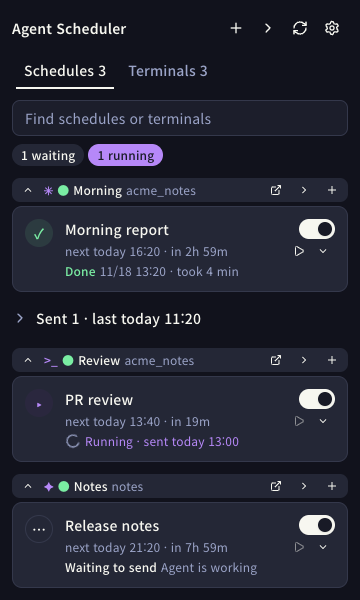

# Agent Scheduler — Orca plugin

Sends a prompt to a Claude Code, Codex or Gemini CLI terminal in Orca at set times. It waits until that terminal is idle, sends through the Orca CLI, and records when the agent finishes — with a one-line result when you ask for one. A schedule is made in the panel, or written into the plugin's inbox folder by a bot or an agent ([Inbox](#inbox--schedules-written-from-outside-as-json-files)). The plugin grew out of the menubar app [OrcaCron](https://github.com/gook-lab/orca-cron) and keeps its own schedules; the two do not share data.

<p>
  
  
</p>

The panel in Orca's right sidebar: schedules grouped by terminal, and the introduction shown the first time it opens. Both pictures are drawn from the demo data in `src/panel.check.ts`.

## Install

```sh
orca plugin install gook-lab/orca-agent-scheduler
```

**macOS only for now**, and Orca 1.4.248 or newer. Prompts go out through the CLI inside the Orca app (`<Orca>.app/Contents/Resources/bin/orca`); on Windows and Linux the plugin does not look for it yet, and the panel says `Orca CLI not found` instead of listing terminals. Orca asks you to approve what the plugin may do before it runs: a worker on your machine that calls the Orca CLI to send prompts, reads terminal output, agent status and your workspaces, reads the schedule files other programs write into `~/.orca-agent-scheduler/inbox`, keeps its own storage and shows notifications.

Update with `orca plugin update gook-lab.agent-scheduler`, and remove it with `orca plugin uninstall gook-lab.agent-scheduler`. What each version changed is in the [release notes](https://github.com/gook-lab/orca-agent-scheduler/releases) (each with a summary in Korean) — **What's new** in the panel's Settings opens them — and in [CHANGELOG.md](CHANGELOG.md).

The panel follows Orca's language: Korean when Orca is in Korean, English otherwise. Settings (the gear at the top) can fix it to English or Korean; the status bar and notifications follow.

## Orca Automations — where this plugin differs

Orca has scheduled runs of its own (`orca automations`, Automations in the app). They start an agent for each run — in a new worktree, or in an existing workspace with a fresh or reused session — and suit work that stands on its own. This plugin types into a terminal you already have open, between your own turns:

| | Orca Automations | Agent Scheduler |
|---|---|---|
| Where the prompt goes | A session the automation starts (new worktree, or an existing workspace) | A terminal you picked, with its conversation so far |
| When it goes out | At the set time | At the set time, once that terminal is idle: still screen, empty input box, no dialog (below) |
| What comes back | The run in Orca's automation history | A one-line result on the card — status, summary, link — and notices |
| Carrying on from the last run | — | `{{last_result}}`, `{{last_link}}`, `{{last_run}}` in the prompt |
| A condition first | `--precheck` | **Precheck**, whose output can go into the prompt as `{{precheck}}` |

Use Automations for a job that needs no one's conversation; use this plugin for "every morning, in the terminal where I review PRs, carry on from yesterday".

## Target — a terminal you pick

A schedule belongs to one terminal you already have open, in any workspace. The terminal list in the form shows only terminals where Orca sees an agent running: the terminal title, then the workspace and the agent. A plain shell is never offered and never sent to. Opened from a terminal line, Edit or Duplicate, the form shows that terminal on one line with **Change**; the list opens only when you press it, and folds again once you pick.

- Orca restarts give terminals new handles. The schedule finds its terminal again by its pane. A terminal that was closed shows as `not open`; the run waits, and you pick another terminal by editing the schedule.
- Orca occasionally drops a working terminal's agent for a second or two. A terminal keeps the agent it was last seen with for two checks (1 minute), so it stays in the list and the form; nothing is sent on that alone — the screen still has to show that agent's input box.
- **Start a new conversation** (schedules only) sends `/clear` first, then the prompt once the screen settles, so each run starts in a new conversation instead of adding to the last one. Claude Code, Codex and Gemini CLI all read `/clear` as a new conversation. Turn it on only for a terminal kept for that schedule — `/clear` erases the conversation in it.
- A schedule keeps its terminal while its run is going. The end of a run is read from the terminal the prompt went to, so the form lets you change the terminal once the run has ended; every other field can be edited meanwhile.
- A schedule written into the inbox has no terminal to point at — a bot's chat is not one. It names a workspace and an agent, and takes the terminal when exactly one fits ([Inbox](#inbox--schedules-written-from-outside-as-json-files)).

## Sending — idle check, then the Orca CLI

At the set time the run becomes due and is checked every 30 seconds. The prompt goes out only when all of these hold:

| Check | Why |
|---|---|
| The terminal has shown nothing new for a minute (5 seconds for Send now and Send once — below) | The agent or a person may still be working. Nothing new is no output, or the same text as at an earlier check: an idle agent repaints its status line, so the time of its last output alone keeps moving (an idle Claude Code, 2026-11-17 — 7 times in 4 minutes, the text the same throughout) |
| Orca does not report the agent as working | In case its end was missed, a working report stops counting once the screen has been still for 3 minutes (5 seconds for Send now and Send once) |
| The input box is visible and empty | A permission or question dialog is open, or a person is typing |
| No other schedule sent to this terminal in the same check | Two prompts would land in one turn |
| No other schedule's run is still going in this terminal | Its end would be read off this run's reply. A run that went silent is closed within 3 minutes, so the wait is short |

A run that waits more than 60 minutes is skipped, with the reason it was waiting.

**Send now** (▷ on a card) and **Send once** are asked for by a person who is looking at the terminal. For them the screen has to be still for 5 seconds, not a minute, and a working report from Orca counts only that long as well: an agent in a turn changes its screen every second or two (its elapsed-time lines tick), while a report whose end never came would keep the run waiting for 3 minutes on an idle terminal. For the first two minutes the run is looked at again every 3 seconds while it waits for something that ends by itself. Text in the input box and a dialog still hold it. On an idle terminal the prompt goes out within seconds; behind a working agent, seconds after it stops (Claude Code, 2026-11-18: 5.5 s on a terminal opened a moment ago; 7 s after the end of a turn, both one that wrote an answer and one that ran a 25-second command printing nothing).

What goes wrong on the way is kept to the one run it belongs to:

| When | Then |
|---|---|
| A send ends in an error that leaves its outcome unknown (the CLI call threw) | The run is recorded as Failed and is not sent again — typed a second time, the prompt could run twice |
| One schedule's check throws | It is logged (`<name>: check failed — …`) and tried again at the next check; the schedules after it still go out |
| The terminal list cannot be read, or comes in a shape this version does not know | Due runs wait, as when the CLI is missing |
| A CLI call hangs (up to a minute) | One check runs and at most one waits behind it; the 30-second timer does not stack more |
| Storage refuses a write from the panel (save, switch, delete, import) | The edit is undone and the form says it could not save — pressing Create again adds one schedule |
| Storage refuses the write after a send | The run stays known to the worker and the write is tried again with the next check |

Checks run only while Orca is running and the computer is awake. A run whose time passed meanwhile is not dropped: at the first check after, it goes out once under the same idle check, and its record and a notification say how late (`sent 6 h 2 min late`). Runs missed in between are not replayed — a schedule every 30 minutes sends one prompt after a night asleep, not sixteen. With **Start a new conversation** on, that late run still clears the terminal first.

Sending uses `orca terminal send --terminal=<handle> --text=<prompt> --enter --wait-submit 8`, run from the CLI inside the running Orca app (`<Orca>.app/Contents/Resources/bin/orca`; the `orca` on PATH can belong to another copy). The terminal and the prompt are joined to their flags with `=`: given apart, a prompt that starts with `--` is read by the CLI as another flag and never reaches the terminal. The plugin API is not used for this because of limits measured on Orca 1.4.255:

| Plugin API | Measured | So |
|---|---|---|
| `terminal.sendText` | Allowed only for terminals in the workspace on screen (`terminal is outside the active worktree`) | Send with the CLI, which reaches every workspace |
| `terminal.read` | Returns no error for a closed terminal | Tell open from closed by the CLI's terminal list |

## End detection — agent status, then the screen

- After sending, Orca's agent status events decide the end: working → done or waiting. An outcome the agent reports becomes Succeeded, Failed or Stopped; without one the run is Done, with the time it took. Waiting for input becomes Done (awaiting input) — orange, since a person is needed — with a notification.
- A done or waiting event while a permission or question dialog is on screen does not end the run. The card shows that a person must answer, and a notification goes out once.
- A run that asked for a result ends when its line is on screen — at the first check that sees it, whatever the events say (see Result).
- If the events are missed, the screen decides: nothing new for 3 minutes with an empty input box is Done. Nothing new with no input box, or with text left in it, is flagged on the card and in the status bar until the screen moves again.
- An agent that ends its turn to wait for its own background command is still at work. No end event came while the command ran (Claude Code 2.1.326 on Orca 1.4.261), so the run stays open until the agent's last reply. Where the events do not come at all, the screen closes the run after 3 minutes — and its result line is still taken when it comes.
- The log says how each run ended: `(agent done)`, `(result line)` or `(by screen)` — `orca plugin logs gook-lab.agent-scheduler`.
- A terminal closed mid-run is Stopped; a run with no end after 6 hours is Timed out.

## Precheck — a command that decides whether to send

A schedule can carry a shell command, under **Precheck** in the form. When the run is due and its terminal is free — every check above has passed — the command runs, then:

| The command | The run |
|---|---|
| Exits 0 | Goes out. What the command printed is the value of `{{precheck}}` |
| Exits with another code | Skipped, in grey like an agent's own skip, with the code and the last line it printed — its error output first (`Precheck said no: exit 1 — no open pull requests`). No notification |
| Cannot run — exit 126 or 127 (not found), more than 30 seconds, no shell | Failed, with a notification: a typo is not a no |

- It runs once per run, before `/clear`: a run that clears first does not run it again for the prompt that follows.
- It runs on this computer, in the terminal's workspace folder when that folder is here; for a workspace on an SSH host or a paired Orca server, in your home folder.
- The shell is your account's login shell, started as a login shell (`zsh -lc` for most), so `PATH` is the one your terminal has. Orca's worker has no `$SHELL` and a shorter `PATH`; without the account's shell the command would run in `/bin/sh`.
- Send now runs it as well. Send once has none.
- **Try it now**, under the command, runs it the same way — in the picked terminal's folder — and says what it would do to the run: go out, be skipped or fail, with the folder and what it printed. Nothing is sent and nothing is saved.

For example `gh pr list --search "review-requested:@me" --json number -q '.[].number' | grep .` sends only when a pull request waits for your review, and `Review these pull requests: {{precheck}}` names them.

## Prompt variables — filled in when the run goes out

| Variable | Value |
|---|---|
| `{{date}}` · `{{time}}` | The local date (`2026-11-25`) and time (`09:00`) when the prompt goes out |
| `{{last_run}}` | When the last run of this schedule that went out was sent (`2026-11-24 09:00`) |
| `{{last_result}}` · `{{last_link}}` | The summary and link of the newest result line — the two from the same run |
| `{{precheck}}` | What the precheck printed (stdout, else stderr) |

- `{{last_result|nothing yet}}` uses the text after `|` when the value is empty — the first run, or a run whose agent wrote no line.
- A value goes in as one line: its lines are joined with `; `, since a line break could reach the input box as Enter and send half the prompt. It is cut at 2,000 characters.
- A name this version does not know stays as typed. The saved prompt keeps its variables; the card shows them unfilled.
- The form shows the prompt as it would go out now (`Goes out as: …`), from this schedule's history; `{{precheck}}` shows what Try it now printed, or a placeholder until it is tried.
- The result line comes from **Ask for a one-line result** (next section); without it `{{last_result}}` and `{{last_link}}` stay empty.

## Result — a last line the agent writes

With **Ask for a one-line result** on (the default for a new schedule; off for Send once, under More options), one sentence is added to the end of the prompt:

> When you finish, end your reply with one line in this form: `[result k3f9 STATUS] one-line summary [link] URL [end]` — STATUS is ok, failed or skipped; leave out "[link] URL" when there is no link.

The worker finds that line on the terminal screen — the screen it already reads for the idle check — and the record shows it: **Succeeded**, **Failed** or **Skipped**, the summary under it, and the link, which opens in your browser. Skipped here is the agent saying there was nothing to do — an ordinary result, in grey; orange is kept for a run that waited 60 minutes and never went out.

| Rule | Why |
|---|---|
| The agent only prints text | Nothing is written or run for this, so it cannot bring up a permission dialog, and nothing in it depends on which agent it is. Checked live on Claude Code and Codex, including a summary and a link wrapped over several lines; not yet on Gemini CLI |
| `k3f9` is that run's tag | A line an earlier run left on screen is not taken for this one. The sentence itself, echoed in the terminal, says `STATUS` and is not a result |
| The newest line that reaches `[end]` counts | A line wrapped to the terminal's width is put back together — the summary with spaces, the link without |
| The line is taken when first seen, and ends the run | The end event may never come, and on a small pane later output pushes the line off the screen before a quiet moment does |
| A line that comes after the end is taken for 60 minutes | An agent that ended its turn to wait for its own background command writes the line when the command is done. The record takes its status, summary and link then, and stops saying the line is missing; a late Failed is notified |
| A mark before the link is passed by | Claude Code draws `⧉` before a link |
| Only `http` and `https` links are kept, and none with a name before the site (`user@site`) | The panel opens them in the browser, and `https://known.site@other.site/` would read as one site and lead to another. The site is the link, shown in full so you can read where it leads; the start of the path follows as text and wraps |
| A turn that failed or was stopped stays so | The line sets the status only of a run that ended normally. A run the agent calls `failed` is announced with its summary |
| A prompt that starts with `/` gets no sentence | It is a command of the agent — text after it would be read as its arguments |
| Without the line there is no result | The run ends as before (Done, Succeeded…), without a summary, and its record says `No result line on screen` — unless it stopped at a question, where the line was not due yet |

The sentence is in the panel's language. A schedule saved before this option keeps it off until you turn it on in Edit.

## Schedule — days, times, calendar, cron

| Field | Choices |
|---|---|
| Days | Every day · Weekdays · Weekends · Pick days (Monday first) · Dates on a calendar (up to 12 months ahead) · Cron |
| Time | Set times (up to 24) or every N minutes (1–720), all day or between two times of the same day (a range that passes midnight is two schedules). Typed as `21:30`, `2130` or `9:30 pm` |
| Cron | Five fields, or six with a year; several expressions joined by `;` |

× (top right) or Cancel closes the form at once when nothing was changed; otherwise it asks before discarding the text, next to the button pressed. The form shows a summary of what it will do (for example `Weekdays 09:00–18:00, every 30 min`), and under it which clock that is: times are the computer's local time, shown with its zone (`Asia/Seoul, UTC+9`). There is no per-schedule time zone. Where clocks change for summer time, a time that does not exist that night runs an hour later, a time that comes twice runs once, and an every-N-minutes schedule does not run during the repeated hour. Create stays off until the form is complete, with the first missing field named above it (name, terminal, time, prompt). After saving, the panel shows the Schedules tab with that terminal's block open. The saved schedule is tinted green for a few seconds. A schedule saved as cron that the form can express reopens in the form.

## Screens — side panel laid out like Orca's own sidebars

The calendar icon in the right sidebar opens the **Agent Scheduler** panel. It is laid out like Orca's file explorer: a title row with icon buttons, tabs, a search box, then the list.

| Part | What it shows and does |
|---|---|
| Introduction | The first time the panel opens, three short pages take the place of the list: prompts on a schedule, only when the terminal is free, start from a terminal. Skip or Get started closes it, and it does not come back by itself; when nothing is scheduled yet, the panel then opens the Terminals tab. Settings opens it again |
| Title row | **Agent Scheduler**, then New schedule (+), Send once (›), Reload terminals (a spinner while the list is read) and Settings. Settings and the form keep the same row: their title on the left, × on the right, a line under it |
| Tabs and search | **Schedules N** and **Terminals N**. Entering Terminals reads the terminal list afresh (the reload button spins meanwhile; what is there stays visible). The search box under them filters both, by terminal title, workspace, agent or schedule name, and opens a folded block that holds a match; a search that hides everything says so with **Clear search** |
| Schedules | Badges for what is out of the ordinary — waiting, running, need attention — and nothing above the list while every schedule is at rest; then one block per terminal. What runs next is on each card and in Orca's status bar, and the switches say what is on. With nothing scheduled, one line and an **Open Terminals** button |
| Terminal line | The agent's mark (Claude Code ✳, Codex `>_`, Gemini CLI ✦), a green dot while the terminal is open, the terminal's title, then its workspace in grey — the order of the form's terminal list. A block is one terminal with its schedules, not a workspace: the buttons on its line act on that terminal alone. Of the room left for words the shorter of the two keeps its width — the workspace up to a third, the title up to two thirds — and the other takes what is left, ending in … when it runs out. In a block the chevron folds it; a folded block reads `2 schedules · next tomorrow 09:00`. ↗ brings Orca to that terminal (`orca terminal switch`). Then **Send once** — one prompt to this terminal only, apart from its schedules — and **New schedule for this terminal** |
| Schedule in a block | A card on a filled surface with a line around it, folded until it is opened. At its left a round mark for a glance down the list: what is going on now — running ▸, a person must act !, waiting to send … — else how the last run went — ✓ succeeded or done, ✕ failed, – skipped (grey when the agent's result says there was nothing to do, orange when the run waited 60 minutes and never went out), ? stopped at a question — a dot when it has not run yet, and an empty circle when the schedule is off. Folded, one column beside the mark so every line starts at the same edge: the switch with the name; the next run with the time left (`next today 19:13 · in 2h 33m`) and two buttons, send now (▷) and open (⌄); then how the last run went as a word in the mark's colour with when and how long — in seconds under a minute — (in its place a spinner while a run is going, and `Waiting to send` with the reason while one waits — the last run then opens with the card), and under it — when that run failed, timed out, was stopped, ended at a question or never went out — one line of why, cut where it runs out: what the agent wrote, else what the plugin knows (`Waited 60 min: agent is working`, `Send failed: …`) — a schedule that has not run yet ends after two lines. Opened in place: the result as a badge, what the agent wrote and its link when the schedule asks for a result, how the run's end was seen, the rule (with `/clear` when it clears first, and the precheck command when there is one), the start of the prompt, **Edit**, **Duplicate** and **Delete**, and the history (the newest 30 runs). A schedule that came from the inbox says so in grey under its other lines — `From Orca bot · inbox` — folded or open, and the search finds it by that name. **Send now** is one run at a time: it is off while the schedule waits to send or its run is going, and when its terminal is closed, and the tooltip says which. **Delete** asks in the card first, in the buttons' place, with how many past results go with it; Undo then stays for 8 seconds in the deleted schedule's place. A run waiting its turn says `Waiting to send` and the reason, in the same column; an orange warning appears only when a person must act (the same ones counted on top and in the status bar), with the next step beside it — **Pick a terminal**, or **Show this terminal in Orca** to answer a dialog or clear the input box — and both show on a folded card too |
| Sent records | One-off sends are folded under their terminal as `Sent N · last today 12:03`. Ones not sent yet are counted apart — `Waiting to send 1 · Sent 2` — so a send stuck on a closed terminal never reads as sent. A new send opens the group and it stays open when that send ends. A finished one shows its result as a schedule's does — how long it took, why it failed, the summary and link. The newest 20 finished ones are kept |
| Terminals | Every open agent terminal, each on the same line as above. With none, it says to run claude, codex or gemini in an Orca terminal, with a reload button (the form's terminal picker says the same). When the worker found no Orca CLI it says that instead, since no terminal could show up. A terminal with schedules shows `Schedules N`; pressing it opens that block on the Schedules tab |
| Settings | Language (same as Orca, English or Korean); **How sending works** — the rule for sending (checked every 30 seconds; nothing new for a minute with an empty input box; skipped after 60 minutes of waiting); Show the introduction again; **What's new**, which opens the release notes; **Inbox** — the folder, how many schedules came from it, and the files of the last check that could not be used, each with the reason; and Import from OrcaCron when that app's schedules are on this computer |

Until the worker first answers, both tabs show a loading placeholder rather than an empty list, and the tab names carry no number (a 0 would read as none).

Text a person or an agent wrote — a name, a summary, the reason in a note, an address — wraps inside its card at any panel width: a run of 16 letters with no space gets a place to break (checked on the real panel at 280, 304 and 457 px).

A closed terminal keeps its block, greyed out, with its last known agent. A schedule there that is switched on says in orange that nothing can be sent, with **Pick a terminal** (Edit, opened at the terminal list); a due run waits until the terminal is open again or you pick another. Schedules from the inbox that have no terminal yet stand the same way, in one block per workspace and agent they wait for.

The status bar shows the next run, and turns orange with a count when a schedule needs attention (terminal not open, no agent, a dialog, text in the input box, the CLI missing).

## Send once — one prompt now

**Send once** (› in the title row, or on a terminal line) opens a short form: terminal, prompt, Send; the name sits under More options. There is no /clear here — a one-off usually carries on the conversation already in that terminal. The prompt goes out under the same idle check as Send now — 5 still seconds, not a schedule's minute — the name may stay empty (the first line of the prompt is used), and the result stays as a sent record under the terminal.

## Import from OrcaCron — the menubar app's schedules

On a computer where the menubar app [OrcaCron](https://github.com/gook-lab/orca-cron) has schedules (`~/.orca-cron/schedules.json`, or under `ORCA_CRON_HOME`), Settings lists them with **Import N schedules**. Anywhere else Settings shows nothing about it.

- What is imported: the name, the times (the same cron), the terminal, **Start a new conversation**, and what to send — the app's own message for a task file or a typed prompt, without its closing "run the finish command". **Ask for a one-line result** takes that command's place.
- What stays in the app: run state, history, one-off sends, and its limit for skipping a late run (here a late run goes out once, marked late).
- Imported schedules arrive **switched off**. Turn each one off in OrcaCron, then on here — while both are on, the prompt goes out twice.
- The terminal is matched by its handle, or by tab and pane after Orca restarted. One that is not open shows as `not open`; pick it again in Edit.
- Importing again adds nothing, and the app's folder is only read.

## Inbox — schedules written from outside as JSON files

A bot or an agent that is asked for a schedule ("every weekday at 9, review my pull requests") cannot press + in the panel. It writes one JSON file into `~/.orca-agent-scheduler/inbox/` instead (`ORCA_AGENT_SCHEDULER_HOME` moves the folder that holds `inbox/`). The worker reads the folder at every check, so the schedule is in the panel within 30 seconds, with a notification (`Orca bot added a schedule: Morning PR review`).

A folder, because nothing else reaches an installed plugin from outside on Orca 1.4.278: the handlers the worker registers answer only the plugin's own panel (`plugin.request`), `orca plugin dev request` refuses installed plugins, and the CLI has no command that calls into one. A file also needs no Orca running when it is written.

### File format — one schedule per file

Any name ending in `.json`; the `id` inside is what counts.

```json
{
  "id": "orca-bot:auto_7f3a",
  "source": "Orca bot",
  "name": "Morning PR review",
  "cron": "0 9 * * 1-5",
  "prompt": "Review the pull requests waiting for me. Last time: {{last_result|nothing yet}}",
  "target": { "workspace": "/Users/me/code/app", "agent": "claude" },
  "newConversation": false,
  "askResult": true,
  "enabled": true
}
```

| Field | Value |
|---|---|
| `id` | The writer's own id for this schedule, up to 200 characters. The same `id` again replaces; with `"deleted": true` it removes. Prefix it with the writer's name so two writers do not collide |
| `source` | Who wrote it, as the card shows it (`From Orca bot · inbox`). Optional, up to 60 characters |
| `name` · `cron` · `prompt` | As in the form. `cron` is five fields, or six with a year, several joined by `;`, in the computer's local time. The prompt may use the [prompt variables](#prompt-variables--filled-in-when-the-run-goes-out) |
| `target` | `workspace` and `agent` — below. `title` is optional |
| `newConversation` | **Start a new conversation** (`/clear` first). Left out = off |
| `askResult` | **Ask for a one-line result**. Left out = on, as for a new schedule in the form |
| `enabled` | Left out = on. `false` brings it in switched off, for a person to turn on |

To remove the schedule, write `{ "id": "orca-bot:auto_7f3a", "deleted": true }` under the same or another name. Deleting the file does nothing: the schedule stays, and is no longer updated.

A file that cannot be used — not JSON, a field missing, times that never come, an `id` another file already has — is passed by, and the others still come in. Settings lists such files with the reason, and the log says it once (`inbox review.json: "cron" not understood`). A file caught half-written is read whole at the next check; writing under another ending and renaming to `.json` avoids even that.

A precheck command is not taken from a file. It runs in your shell, so it stays something you type in the panel; add it there with Edit.

### Target — workspace folder and agent

The writer has no terminal to point at, so it says where the work belongs:

| Field | Value |
|---|---|
| `workspace` | The workspace's folder (`~` allowed), a folder inside it — the deepest workspace that holds it counts — or the Orca workspace id |
| `agent` | `claude`, `codex` or `gemini` |
| `title` | Optional: only the terminal with this title (letter case aside) |

- Exactly one open terminal in that workspace runs that agent: the schedule goes on it, as if picked in the form.
- None, or more than one: the schedule arrives without a terminal. Its card says so in orange — `No Claude Code terminal to send to in app` — with **Pick a terminal**, and a run that falls due waits like one whose terminal was closed (skipped after 60 minutes). Between two terminals nothing is guessed: with `newConversation` a wrong guess would erase a conversation.
- A schedule without a terminal is matched again at every check, and takes the terminal once exactly one fits — start `claude` in that workspace and it goes there by itself.
- Once it has a terminal — matched or picked — it keeps it like any other schedule. The target is looked at again only when the writer changes it.

### Updates — field-by-field merge of the writer's changes and a person's edits

The file stays in the folder; the plugin never writes to it or deletes it. What it last applied is remembered per `id` in the plugin's own storage, and a file is acted on only when it reads differently from that.

| What happens | Then |
|---|---|
| The file is unchanged | Nothing. What you edited in the panel stays — and so does a schedule you deleted there |
| The writer changes the file | Only the fields whose value changed in the file are replaced. You renamed it and the writer moved the time: the new time, your name. The switch is a field like the others — one you turned off stays off until the writer changes `enabled` |
| The writer changes a field you also edited | The writer's value. The form says so when you open Edit on such a schedule |
| You deleted it, then the writer changes the file | It comes back, as the new file says |
| The writer changes `target` while a run is going | The whole file waits until that run has ended |
| The writer writes `"deleted": true` | The schedule and its history are removed. Written again without the mark, it is a new schedule |

History, the last result and a run in flight are untouched by an update. Duplicate makes a copy that is yours: it has no source and the writer cannot reach it.

### Writer example — an Orca bot automation mirrored into the inbox

Asked for a recurring job, the Orca bot creates an Orca automation. To have the same schedule in this panel — sent into the terminal you already work in — it writes one more file, with the automation's id in `id` so that a later edit or removal finds the same schedule:

```json
{
  "id": "orca-automation:d42233f8-5dcc-4489-abed-e2f99b99f06c",
  "source": "Orca bot",
  "name": "Branch sync ledger, weekly",
  "cron": "0 10 * * 1",
  "prompt": "Check the branch-sync ledger for new commits since the last baseline and report what is missing.",
  "target": { "workspace": "/Users/me/code/docs", "agent": "claude" },
  "newConversation": true,
  "askResult": true
}
```

```sh
mkdir -p ~/.orca-agent-scheduler/inbox
f=~/.orca-agent-scheduler/inbox/orca-automation-d42233f8
cat > "$f.tmp" < schedule.json && mv "$f.tmp" "$f.json"
```

- When the automation is edited, write the file again with the same `id`; when it is removed, write `{ "id": "orca-automation:d42233f8-…", "deleted": true }`.
- An automation starts its own session, and this schedule types into your terminal: with both on, the work is done twice. Keep one on — create the automation with `--disabled`, or put `"enabled": false` in the file and let the person choose.
- Without this plugin the file is never read and changes nothing, so a bot may write it either way.

Up to 200 files are read, in name order, each up to 256 KB; only plain files are opened.

## Permissions — screen, status, CLI

| Permission | Used for |
|---|---|
| `terminal:read` | Reading the chosen terminal's screen for the idle check, dialogs and the end |
| `agent:read` | Agent status events for the end |
| `workspace:read` | Workspace names in the terminal menu |
| `storage:own` | Schedules and the language setting |
| `notifications:show` | A run that needs a person, one that failed (its precheck included), was stopped, timed out or was skipped after 60 minutes, and one sent late |

Sending, showing a terminal and the terminal list go through the Orca CLI, so they do not appear as permissions. The worker runs as a trusted Node process under your account, as the approval text says, which is what lets it run the CLI. The same access reads two things outside the plugin's own storage, and writes to neither: `~/.orca-cron/schedules.json` for Import from OrcaCron, and the `*.json` files in `~/.orca-agent-scheduler/inbox`, where a bot or an agent leaves schedules ([Inbox](#inbox--schedules-written-from-outside-as-json-files)). It also runs a schedule's precheck command — one you typed, never one from a file — in your login shell. Apart from what that command does, the worker reads and writes no other file.

The inbox adds no new reach. A program that can write into that folder runs under your account, and could already type into your terminals through the Orca CLI. What it adds is visible: a schedule from the inbox is announced with a notification when it arrives and names its writer on its card. The plugin makes no network request of its own (a precheck such as `gh pr list` makes its own); a result link and **What's new** open in your browser only when you press them.

## Development — orca plugin test · check

```bash
ORCA="/Applications/Orca.app/Contents/Resources/bin/orca"   # the CLI of the Orca app you run
$ORCA plugin test .                # tests: schedule maths, screen checks, engine, worker, panel
$ORCA plugin check . --json        # draws the panel once per scenario (first · empty · open · late · result · stuck · inbox · busy · korean)
npx -p typescript tsc -p . --noEmit
$ORCA plugin dev watch . --check   # load into Orca, reload on each edit (a new permission needs a new approval)
```

The README pictures are scenarios from `src/panel.check.ts`, shot while Orca's window is hidden or minimized (straight from this folder — they are drawn with a stand-in host, so no dev load and no real schedules):

```bash
$ORCA plugin shot . --scenario open  --theme dark --width 360 --out docs/panel-schedules.png
$ORCA plugin shot . --scenario first --theme dark --width 360 --out docs/panel-first.png
$ORCA plugin shot . --scenario late   --theme dark --width 360 --out docs/panel-late.png     # plugin page screenshots
$ORCA plugin shot . --scenario korean --theme dark --width 360 --out docs/panel-korean.png
```

The plugin page's icon, cover and screenshots are `docs/icon.svg`, `docs/cover.html` and `docs/gallery.html` (which show the pictures above), rendered with headless Chrome:

```bash
CHROME="/Applications/Google Chrome.app/Contents/MacOS/Google Chrome"
"$CHROME" --headless=new --hide-scrollbars --force-device-scale-factor=1 --default-background-color=00000000 --window-size=512,512 --screenshot="$PWD/docs/icon.png" "file://$PWD/docs/icon.svg"
"$CHROME" --headless=new --hide-scrollbars --force-device-scale-factor=1 --window-size=1280,800 --screenshot="$PWD/docs/cover.png" "file://$PWD/docs/cover.html"
for n in late korean; do "$CHROME" --headless=new --hide-scrollbars --force-device-scale-factor=1 --window-size=1280,800 --screenshot="$PWD/docs/shot-$n.png" "file://$PWD/docs/gallery.html#$n"; done
```

A version is a tag, and its notes are a release — the version's section of `CHANGELOG.md`, with a short summary in Korean added under it:

```bash
V=0.10.0   # the version in orca-plugin.json, with its section in CHANGELOG.md
git tag -a "v$V" -m "v$V" && git push origin main "v$V"
awk -v v="$V" '$0 ~ "^## " v " " { on = 1; next } /^## / { on = 0 } on' CHANGELOG.md > notes.md
gh release create "v$V" --title "v$V" --notes-file notes.md   # notes.md is not kept in the repository
```

## License — MIT

MIT — see [LICENSE](LICENSE).
