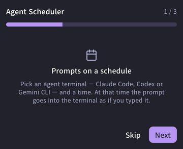

# Agent Scheduler — Orca plugin

Sends a prompt to a Claude Code, Codex or Gemini CLI terminal in Orca at set times. It waits until that terminal is idle, sends through the Orca CLI, and records when the agent finishes — with a one-line result when you ask for one. The plugin grew out of the menubar app [OrcaCron](https://github.com/gook-lab/orca-cron) and keeps its own schedules; the two do not share data.

<p>
  
  
</p>

The panel in Orca's right sidebar: schedules grouped by terminal, and the introduction shown the first time it opens. Both pictures are drawn from the demo data in `src/panel.check.ts`.

## Install

```sh
orca plugin install gook-lab/orca-agent-scheduler
```

**macOS only for now**, and Orca 1.4.248 or newer. Prompts go out through the CLI inside the Orca app (`<Orca>.app/Contents/Resources/bin/orca`); on Windows and Linux the plugin does not look for it yet, and the panel says `Orca CLI not found` instead of listing terminals. Orca asks you to approve what the plugin may do before it runs: a worker on your machine that calls the Orca CLI to send prompts, reads terminal output, agent status and your workspaces, keeps its own storage and shows notifications. Updates: `orca plugin update gook-lab.agent-scheduler`.

Update with `orca plugin update gook-lab.agent-scheduler`. What each version changed is in the [release notes](https://github.com/gook-lab/orca-agent-scheduler/releases) (each with a summary in Korean) — **What's new** in the panel's Settings opens them — and in [CHANGELOG.md](CHANGELOG.md).

The panel follows Orca's language: Korean when Orca is in Korean, English otherwise. Settings (the gear at the top) can fix it to English or Korean; the status bar and notifications follow.

## Target — a terminal you pick

A schedule belongs to one terminal you already have open, in any workspace. The terminal list in the form shows only terminals where Orca sees an agent running: the terminal title, then the workspace and the agent. A plain shell is never offered and never sent to. Opened from a terminal line, Edit or Duplicate, the form shows that terminal on one line with **Change**; the list opens only when you press it, and folds again once you pick.

- Orca restarts give terminals new handles. The schedule finds its terminal again by its pane. A terminal that was closed shows as `not open`; the run waits, and you pick another terminal by editing the schedule.
- Orca now and then drops a working terminal's agent for a second or two. A terminal keeps the agent it was last seen with for two checks (1 minute), so it stays in the list and the form; nothing is sent on that alone — the screen still has to show that agent's input box.
- **Start a new conversation** (schedules only) sends `/clear` first, then the prompt once the screen settles, so each run starts fresh instead of piling onto the last one. Claude Code, Codex and Gemini CLI all read `/clear` as a new conversation. Turn it on only for a terminal kept for that schedule — `/clear` erases the conversation in it.

## Sending — idle check, then the Orca CLI

At the set time the run becomes due and is checked every 30 seconds. The prompt goes out only when all of these hold:

| Check | Why |
|---|---|
| The terminal has shown nothing new for a minute (5 seconds for Send now and Send once — below) | The agent or a person may still be working. Nothing new is no output, or the same text as at an earlier check: an idle agent repaints its status line, so the time of its last output alone keeps moving (an idle Claude Code, 2026-11-17 — 7 times in 4 minutes, the text the same throughout) |
| Orca does not report the agent as working | A working report older than 3 minutes is ignored, in case its end was missed |
| The input box is visible and empty | A permission or question dialog is open, or a person is typing |
| No other schedule sent to this terminal in the same check | Two prompts would land in one turn |
| No other schedule's run is still going in this terminal | Its end would be read off this run's reply. A run that went silent is closed within 3 minutes, so the wait is short |

A run that waits more than 60 minutes is skipped, with the reason it was waiting.

**Send now** (▷ on a card) and **Send once** are asked for by a person who is looking at the terminal. For them the first check is 5 seconds, not a minute, and while only that holds the run it is looked at again every 3 seconds — and at once when an agent reports a stop. The other checks are the same. On a resting terminal the prompt goes out within seconds; behind a working agent, seconds after it stops (Claude Code, 2026-11-18: 5.5 s on a terminal opened a moment ago, 7 s after the end of a turn — a minute and a half and more before).

What goes wrong on the way is kept to the one run it belongs to:

| When | Then |
|---|---|
| A send ends in an error nobody saw the end of (the CLI call threw) | The run is recorded as Failed and is not sent again — typed a second time, the prompt could run twice |
| One schedule's check throws | It is logged (`<name>: check failed — …`) and tried again at the next check; the schedules after it still go out |
| The terminal list cannot be read, or comes in a shape this version does not know | Due runs wait, as when the CLI is missing |
| A CLI call hangs (up to a minute) | One check runs and at most one waits behind it; the 30-second timer does not stack more |
| Storage refuses a write from the panel (save, switch, delete, import) | The edit is undone and the form says it could not save — pressing Create again adds one schedule |
| Storage refuses the write after a send | The run stays known to the worker and the write is tried again with the next check |

Checks run only while Orca is running and the computer is awake. A run whose time passed meanwhile is not dropped: at the first check after, it goes out once under the same idle check, and its record and a notification say how late (`sent 6 h 2 min late`). Runs missed in between are not replayed — a schedule every 30 minutes sends one prompt after a night asleep, not sixteen. With **Start a new conversation** on, that late run still clears the terminal first.

Sending uses `orca terminal send --terminal=<handle> --text=<prompt> --enter --wait-submit 8`, run from the CLI inside the running Orca app (`<Orca app>/Contents/Resources/bin/orca`; the `orca` on PATH can belong to another copy). The values are joined to their flags with `=`: given apart, a prompt that starts with `--` is read by the CLI as another flag and never reaches the terminal. The plugin API is not used for this because of limits measured on Orca 1.4.255:

| Plugin API | Measured | So |
|---|---|---|
| `terminal.sendText` | Allowed only for terminals in the workspace on screen (`terminal is outside the active worktree`) | Send with the CLI, which reaches every workspace |
| `terminal.read` | Returns no error for a closed terminal | Tell open from closed by the CLI's terminal list |

## End detection — agent status, then the screen

- After sending, Orca's agent status events decide the end: working → done or waiting. An outcome the agent reports becomes Succeeded, Failed or Stopped; without one the run is Done, with the time it took. Waiting for input becomes Done (awaiting input) — orange, since a person is needed — with a notification.
- A done or waiting event while a permission or question dialog is on screen does not end the run. The card shows that a person must answer, and a notification goes out once.
- A run that asked for a result ends when its line is on screen — at the first check that sees it, whatever the events say (see Result).
- If the events are missed, the screen decides: nothing new for 3 minutes with an empty input box is Done. Nothing new with no input box, or with text left in it, is flagged on the card and in the status bar until the screen moves again.
- An agent that ends its turn to wait for its own background command is still at work. No end event came while the command ran (Claude Code 2.1.326 on Orca 1.4.261), so the run stays open until the agent's last reply. Where the events do not come at all, the screen closes the run after 3 minutes — and its result line is still taken when it comes.
- The log says how each run ended: `(agent done)`, `(result line)` or `(by screen)` — `orca plugin logs gook-lab.agent-scheduler`.
- A terminal closed mid-run is Stopped; a run with no end after 6 hours is Timed out.

## Result — a last line the agent writes

With **Ask for a one-line result** on (the default for a new schedule; off for Send once, under More options), one sentence is added to the end of the prompt:

> When you finish, end your reply with one line in this form: `[result k3f9 STATUS] one-line summary [link] URL [end]` — STATUS is ok, failed or skipped; leave out "[link] URL" when there is no link.

The worker finds that line on the terminal screen — the screen it already reads for the idle check — and the record shows it: **Succeeded**, **Failed** or **Skipped**, the summary under it, and the link, which opens in your browser.

| Rule | Why |
|---|---|
| The agent only prints text | Nothing is written or run for this, so no permission dialog can come of it, and nothing in it depends on which agent it is. Checked live on Claude Code and Codex, including a summary and a link wrapped over several lines; not yet on Gemini CLI |
| `k3f9` is that run's tag | A line an earlier run left on screen is not taken for this one. The sentence itself, echoed in the terminal, says `STATUS` and is not a result |
| The newest line that reaches `[end]` counts | A line wrapped to the terminal's width is put back together — the summary with spaces, the link without |
| The line is taken when first seen, and ends the run | The end event may never come, and on a small pane later output pushes the line off the screen before a quiet moment does |
| A line that comes after the end is taken for 60 minutes | An agent that ended its turn to wait for its own background command writes the line when the command is done. The record takes its status, summary and link then, and stops saying the line is missing; a late Failed is notified |
| A mark before the link is passed by | Claude Code draws `⧉` before a link |
| Only `http` and `https` links are kept, and none with a name before the site (`user@site`) | The panel opens them in the browser, and `https://known.site@other.site/` would read as one site and lead to another. The site is the link, shown in full so you can read where it leads; the start of the path follows as text and wraps |
| A turn that failed or was stopped stays so | The line sets the status only of a run that ended normally. A run the agent calls `failed` is announced with its summary |
| A prompt that starts with `/` gets no sentence | It is a command of the agent — text after it would be read as its arguments |
| No line, no result | The run ends as before (Done, Succeeded…), without a summary, and its record says `No result line on screen` — unless it stopped at a question, where the line was not due yet |

The sentence is in the panel's language. A schedule saved before this option keeps it off until you turn it on in Edit.

## Schedule — days, times, calendar, cron

| Field | Choices |
|---|---|
| Days | Every day · Weekdays · Weekends · Pick days (Monday first) · Dates on a calendar (up to 12 months ahead) · Cron |
| Time | Set times (up to 24) or every N minutes (1–720), all day or between two times. Typed as `21:30`, `2130` or `9:30 pm` |
| Cron | Five fields, or six with a year; several expressions joined by `;` |

× (top right) or Cancel leaves at once when nothing was changed; otherwise it asks before throwing the text away, next to the button pressed. The form shows a summary of what it will do (for example `Weekdays 09:00–18:00, every 30 min`), and under it which clock that is: times are the computer's local time, shown with its zone (`Asia/Seoul, UTC+9`). There is no per-schedule time zone. Where clocks change for summer time, a time that does not exist that night runs an hour later, a time that comes twice runs once, and an every-N-minutes schedule rests through the repeated hour. Create stays off until the form is complete, with the first missing field named above it (name, terminal, time, prompt). After saving, the panel shows the Schedules tab with that terminal's block open. The saved schedule is tinted green for a few seconds. A schedule saved as cron that the form can express reopens in the form.

## Screens — side panel laid out like Orca's own sidebars

The calendar icon in the right sidebar opens the **Agent Scheduler** panel. It is laid out like Orca's file explorer: a title row with icon buttons, tabs, a search box, then the list.

| Part | What it shows and does |
|---|---|
| Introduction | The first time the panel opens, three short pages take the place of the list: prompts on a schedule, only when the terminal is free, start from a terminal. Skip or Get started ends it for good; when nothing is scheduled yet, it lands on the Terminals tab. Settings opens it again |
| Title row | **Agent Scheduler**, then New schedule (+), Send once (›), Reload terminals (a spinner while the list is read) and Settings. Settings and the form keep the same row: their title on the left, × on the right, a line under it |
| Tabs and search | **Schedules N** and **Terminals N**. Entering Terminals reads the terminal list afresh (the reload button spins meanwhile; what is there stays in sight). The search box under them filters both, by terminal title, workspace, agent or schedule name, and opens a folded block that holds a match; a search that hides everything says so with **Clear search** |
| Schedules | Badges for what is out of the ordinary — waiting, running, need attention — and nothing above the list while every schedule is at rest; then one block per terminal. What runs next is on each card and in Orca's status bar, and the switches say what is on. With nothing scheduled, one line and an **Open Terminals** button |
| Terminal line | The agent's mark (Claude Code ✳, Codex `>_`, Gemini CLI ✦), a green dot while the terminal is open, workspace and title. In a block, pressing the workspace folds the block, as rows do in Orca's own trees; a folded block reads `2 schedules · next tomorrow 09:00`. ↗ brings Orca to that terminal (`orca terminal switch`). Then **Send once** and **New schedule for this terminal** |
| Schedule in a block | A card on a filled surface with a line around it, folded until it is opened. At its left a round mark for a glance down the list: what is going on now — running ▸, a person must act !, waiting to send … — else how the last run went — ✓ succeeded or done, ✕ failed, – skipped, ? stopped at a question — a dot when it has not run yet, and an empty circle when the schedule is off. Folded, one column beside the mark so every line starts at the same edge: the switch with the name; the next run with the time left (`next today 19:13 · in 2h 33m`) and two buttons, send now (▷) and open (⌄); then how the last run went as a word in the mark's colour with when and how long (in its place a spinner while a run is going, and `Waiting to send` with the reason while one waits — the last run then opens with the card), and under it — when that run failed, timed out, was stopped or ended at a question — one line of what the agent wrote, cut where it runs out — a schedule that has not run yet ends after two lines. Opened in place: the result as a badge, what the agent wrote and its link when the schedule asks for a result, how the run's end was seen, the rule (with `/clear` when it clears first), the start of the prompt, **Edit**, **Duplicate** and **Delete**, and the history. **Send now** is one run at a time: it is off while the schedule waits to send or its run is going, and when its terminal is closed, and the tooltip says which. **Delete** asks in the card first, in the buttons' place, with how many past results go with it; Undo then stays for 8 seconds in the deleted schedule's place. A run waiting its turn says `Waiting to send` and the reason, in the same column; an orange warning appears only when a person must act (the same ones counted on top and in the status bar), with the way out beside it — **Pick a terminal**, or **Show this terminal in Orca** to answer a dialog or clear the input box — and both show on a folded card too |
| Sent records | One-off sends sit folded under their terminal as `Sent N · last today 12:03`. Ones not sent yet are counted apart — `Waiting to send 1 · Sent 2` — so a send stuck on a closed terminal never reads as sent. A new send opens the group and it stays open when that send ends. A finished one shows its result as a schedule's does — how long it took, why it failed, the summary and link. The newest 20 finished ones are kept |
| Terminals | Every open agent terminal, each on the same line as above. With none, it says to run claude, codex or gemini in an Orca terminal, with a reload button (the form's terminal picker says the same). When the worker found no Orca CLI it says that instead, since no terminal could show up. A terminal with schedules shows `Schedules N`; pressing it opens that block on the Schedules tab |
| Settings | Language (same as Orca, English or Korean); **How sending works** — the rule for sending (checked every 30 seconds; nothing new for a minute with an empty input box; skipped after 60 minutes of waiting); Show the introduction again; **What's new**, which opens the release notes; and Import from OrcaCron when that app's schedules are on this computer |

Until the worker first answers, both tabs show a loading placeholder rather than an empty list, and the tab names carry no number (a 0 would read as none).

Text a person or an agent wrote — a name, a summary, the reason in a note, an address — wraps inside its card at any panel width: a run of 16 letters with no space gets a place to break (checked on the real panel at 280, 304 and 457 px).

A closed terminal keeps its block, greyed out, with its last known agent. A schedule there that is switched on says in orange that nothing can be sent, with **Pick a terminal** (Edit, opened at the terminal list); a due run waits until the terminal is open again or you pick another.

The status bar shows the next run, and turns orange with a count when a schedule needs attention (terminal not open, no agent, a dialog, text in the input box, the CLI missing).

## Send once — one prompt now

**Send once** (› in the title row, or on a terminal line) opens a short form: terminal, prompt, Send; the name sits under More options. There is no /clear here — a one-off usually carries on the conversation already in that terminal. The prompt goes out under the same idle check as Send now — 5 still seconds, not a schedule's minute — the name may stay empty (the first line of the prompt is used), and the result stays as a sent record under the terminal.

## Import from OrcaCron — the menubar app's schedules

On a computer where the menubar app [OrcaCron](https://github.com/gook-lab/orca-cron) has schedules (`~/.orca-cron/schedules.json`, or under `ORCA_CRON_HOME`), Settings lists them with **Import N schedules**. Anywhere else Settings shows nothing about it.

- What comes over: the name, the times (the same cron), the terminal, **Start a new conversation**, and what to send — the app's own message for a task file or a typed prompt, without its closing "run the finish command". **Ask for a one-line result** takes that command's place.
- What stays in the app: run state, history, one-off sends, and its limit for skipping a late run (here a late run goes out once, marked late).
- Imported schedules arrive **switched off**. Turn each one off in OrcaCron, then on here — while both are on, the prompt goes out twice.
- The terminal is matched by its handle, or by tab and pane after Orca restarted. One that is not open shows as `not open`; pick it again in Edit.
- Importing again adds nothing, and the app's folder is only read.

## Permissions — screen, status, CLI

| Permission | Used for |
|---|---|
| `terminal:read` | Reading the chosen terminal's screen for the idle check, dialogs and the end |
| `agent:read` | Agent status events for the end |
| `workspace:read` | Workspace names in the terminal menu |
| `storage:own` | Schedules and the language setting |
| `notifications:show` | Answers needed, failures |

Sending, showing a terminal and the terminal list go through the Orca CLI, so they do not appear as permissions. The worker runs as a trusted Node process under your account, as the approval text says, which is what lets it run the CLI. The same access reads `~/.orca-cron/schedules.json` for Import from OrcaCron; the worker reads and writes no other file.

## Development — orca plugin test · check

```bash
ORCA="/Applications/Orca.app/Contents/Resources/bin/orca"   # the CLI of the Orca app you run
$ORCA plugin test .                # tests: schedule maths, screen checks, engine, worker, panel
$ORCA plugin check . --json        # draws the panel once per scenario (first · empty · open · late · result · stuck · busy · korean)
npx -p typescript tsc -p . --noEmit
$ORCA plugin dev watch . --check   # load into Orca, reload on each edit (a new permission needs a new approval)
```

The README pictures are scenarios from `src/panel.check.ts`, shot while Orca's window is hidden or minimized (straight from this folder — they are drawn with a stand-in host, so no dev load and no real schedules):

```bash
$ORCA plugin shot . --scenario open  --theme dark --width 360 --out docs/panel-schedules.png
$ORCA plugin shot . --scenario first --theme dark --width 360 --out docs/panel-first.png
$ORCA plugin shot . --scenario late   --theme dark --width 360 --out docs/panel-late.png     # plugin page screenshots
$ORCA plugin shot . --scenario korean --theme dark --width 360 --out docs/panel-korean.png
```

The plugin page's icon, cover and screenshots are `docs/icon.svg`, `docs/cover.html` and `docs/gallery.html` (which show the pictures above), rendered with headless Chrome:

```bash
CHROME="/Applications/Google Chrome.app/Contents/MacOS/Google Chrome"
"$CHROME" --headless=new --hide-scrollbars --force-device-scale-factor=1 --default-background-color=00000000 --window-size=512,512 --screenshot="$PWD/docs/icon.png" "file://$PWD/docs/icon.svg"
"$CHROME" --headless=new --hide-scrollbars --force-device-scale-factor=1 --window-size=1280,800 --screenshot="$PWD/docs/cover.png" "file://$PWD/docs/cover.html"
for n in late korean; do "$CHROME" --headless=new --hide-scrollbars --force-device-scale-factor=1 --window-size=1280,800 --screenshot="$PWD/docs/shot-$n.png" "file://$PWD/docs/gallery.html#$n"; done
```

A version is a tag, and its notes are a release — the version's section of `CHANGELOG.md`, with a short summary in Korean added under it:

```bash
V=0.10.0   # the version in orca-plugin.json, with its section in CHANGELOG.md
git tag -a "v$V" -m "v$V" && git push origin main "v$V"
awk -v v="$V" '$0 ~ "^## " v " " { on = 1; next } /^## / { on = 0 } on' CHANGELOG.md > notes.md
gh release create "v$V" --title "v$V" --notes-file notes.md   # notes.md is not kept in the repository
```
